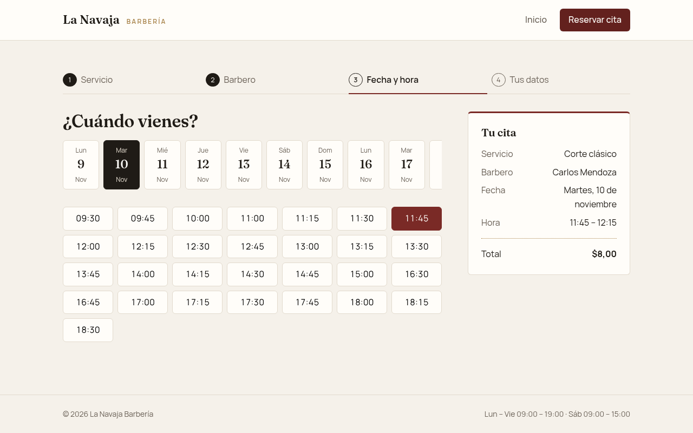
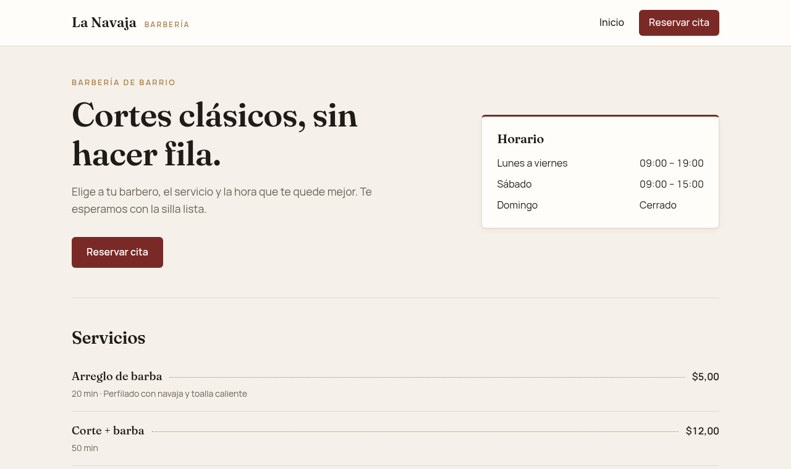
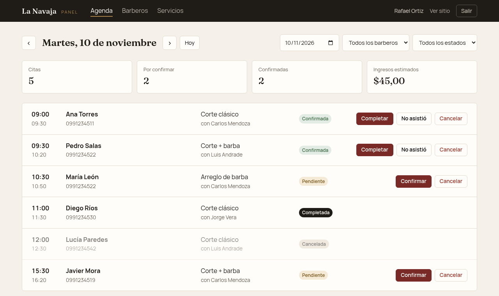
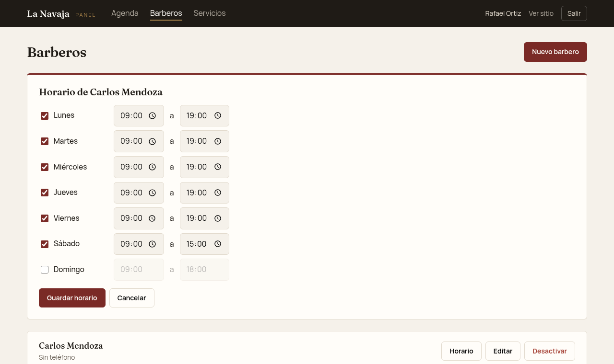
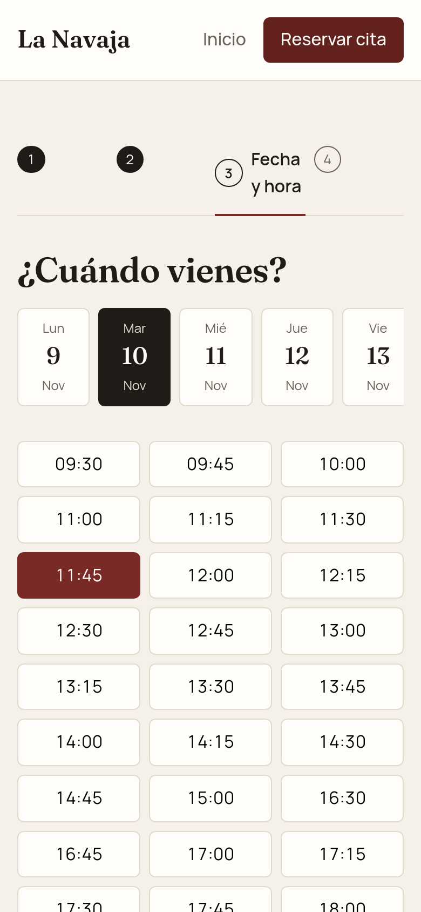
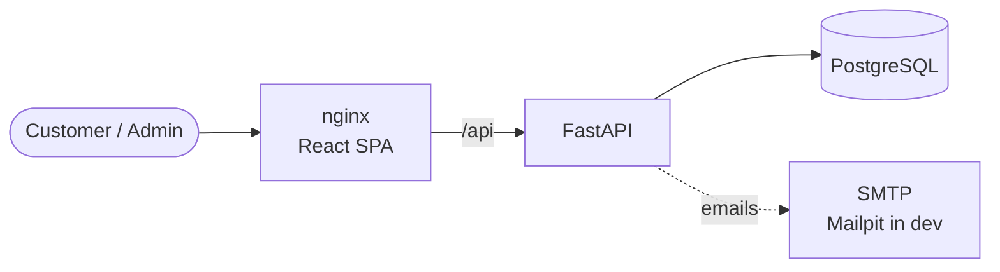

<div align="center">

# ✂️ Barbershop Booking

**Online appointment booking for barbershops.**
Customers pick a service, a barber and a free time slot; owners manage the
agenda, the team and the schedule from an admin panel.

[](https://github.com/Steeven24/barbershop-booking/actions/workflows/ci.yml)




</div>

## ✨ Features

**For customers**

- Home page with services, prices, team and opening hours
- 4-step booking: service → barber → day & time → contact details
- Real-time availability from each barber's weekly schedule and existing bookings
- Email when the booking is received, confirmed or cancelled

**For the barbershop**

- Admin panel with secure login (JWT, Argon2 password hashing)
- Daily agenda with filters, a summary of the day and one-click status changes
- Manage barbers, services and each barber's weekly schedule

**Under the hood**

- Double-booking protection with row locking, plus a friendly retry in the UI
- All times handled in the business timezone
- Fully configured through environment variables — no secrets in the repo
- Tested API, CI on every pull request and a one-command Docker setup

## 📸 Screenshots

| Home | Admin agenda |
| :---: | :---: |
|  |  |
| **Weekly schedule editor** | **Booking on mobile** |
|  |  |

## 🧰 Tech stack

| Layer          | Technology                                                    |
| -------------- | ------------------------------------------------------------- |
| Frontend       | React 19, TypeScript, Vite, React Router, CSS Modules          |
| Backend        | FastAPI, SQLAlchemy 2, Alembic, Pydantic, PyJWT, pwdlib        |
| Database       | PostgreSQL 16                                                  |
| Tooling        | uv, Ruff, pytest, oxlint                                       |
| Infrastructure | Docker, nginx, GitHub Actions, Mailpit (local email)           |

## 🏗️ Architecture



## 📁 Project structure

```
barbershop-booking/
├── backend/                # FastAPI REST API
│   ├── app/
│   │   ├── models/         # SQLAlchemy models
│   │   ├── routers/        # API endpoints
│   │   ├── schemas/        # Pydantic request/response models
│   │   ├── scheduling.py   # Availability and booking rules
│   │   └── notifications.py
│   ├── migrations/         # Alembic migrations
│   └── tests/
├── frontend/               # React SPA (public site + admin panel)
│   └── src/
│       ├── api/            # Typed API client
│       ├── components/     # UI components (booking, admin, layout)
│       └── pages/
├── docs/screenshots/
├── .github/workflows/      # CI
└── docker-compose.yml
```

## 🚀 Quick start (Docker)

Requires Docker with Compose v2.

```bash
git clone https://github.com/Steeven24/barbershop-booking.git
cd barbershop-booking

cp .env.example .env                   # database user, password and name
cp backend/.env.example backend/.env   # SECRET_KEY and other settings
# Fill in the values (see Configuration below), then:

docker compose up -d --build
docker compose exec backend python -m app.cli create-admin you@example.com "Your Name"
```

| Service       | URL                          |
| ------------- | ---------------------------- |
| App           | http://localhost:8080        |
| Admin panel   | http://localhost:8080/admin  |
| Email inbox   | http://localhost:8025        |

Migrations run automatically when the backend container starts.

## 🛠️ Local development

Requirements: Python 3.12+, [uv](https://docs.astral.sh/uv/), Node.js 20+ and Docker.

```bash
docker compose up -d db mailpit        # PostgreSQL + local email inbox
```

**Backend** — http://localhost:8000/docs

```bash
cd backend
uv sync
uv run alembic upgrade head
uv run python -m app.cli create-admin you@example.com "Your Name"
uv run fastapi dev app/main.py
```

**Frontend** — http://localhost:5173 (Vite proxies `/api` to the backend)

```bash
cd frontend
npm install
npm run dev
```

After changing models, create a migration with
`uv run alembic revision --autogenerate -m "describe change"`.

## ⚙️ Configuration

All settings come from environment variables; secrets are never committed.
`.env.example` files list every variable with empty placeholders.

| Variable                               | Where           | Description                                        |
| -------------------------------------- | --------------- | -------------------------------------------------- |
| `POSTGRES_USER` / `_PASSWORD` / `_DB`  | `.env`          | Database credentials used by Docker Compose        |
| `DATABASE_URL`                         | `backend/.env`  | SQLAlchemy URL (same credentials as above)         |
| `SECRET_KEY`                           | `backend/.env`  | JWT signing key, at least 32 characters            |
| `ACCESS_TOKEN_EXPIRE_MINUTES`          | `backend/.env`  | Admin session length (default 480)                 |
| `TIMEZONE`                             | `backend/.env`  | Business timezone (default `America/Guayaquil`)    |
| `BUSINESS_NAME`                        | `backend/.env`  | Name used in emails                                |
| `SMTP_HOST`, `SMTP_PORT`, `SMTP_USER`, `SMTP_PASSWORD`, `SMTP_STARTTLS`, `EMAIL_FROM` | `backend/.env` | Email delivery. Without `SMTP_HOST` emails are only logged |

Generate a secret key with:

```bash
python -c "import secrets; print(secrets.token_urlsafe(48))"
```

The backend refuses to start if `DATABASE_URL` or `SECRET_KEY` are missing.

## 📡 API

Interactive docs at `/docs` when the backend runs locally. Admin endpoints need
`Authorization: Bearer <token>` from `POST /api/auth/login`.

<details>
<summary>Endpoint reference</summary>

| Method | Path                              | Access | Description                  |
| ------ | --------------------------------- | ------ | ---------------------------- |
| POST   | `/api/auth/login`                 | Public | Get an admin access token    |
| GET    | `/api/auth/me`                    | Admin  | Current admin                |
| GET    | `/api/barbers`, `/api/barbers/{id}` | Public | List / get barbers         |
| POST   | `/api/barbers`                    | Admin  | Create barber                |
| PATCH  | `/api/barbers/{id}`               | Admin  | Update barber                |
| DELETE | `/api/barbers/{id}`               | Admin  | Deactivate barber            |
| GET    | `/api/barbers/{id}/working-hours` | Public | Weekly schedule              |
| PUT    | `/api/barbers/{id}/working-hours` | Admin  | Replace weekly schedule      |
| GET    | `/api/services`, `/api/services/{id}` | Public | List / get services      |
| POST   | `/api/services`                   | Admin  | Create service               |
| PATCH  | `/api/services/{id}`              | Admin  | Update service               |
| DELETE | `/api/services/{id}`              | Admin  | Deactivate service           |
| GET    | `/api/availability`               | Public | Free slots for barber/day    |
| POST   | `/api/appointments`               | Public | Book an appointment          |
| GET    | `/api/appointments`               | Admin  | List with filters            |
| GET    | `/api/appointments/{id}`          | Admin  | Get appointment              |
| PATCH  | `/api/appointments/{id}/status`   | Admin  | Confirm / complete / cancel  |

Appointment status flow: `pending → confirmed → completed | no_show`, and
`pending | confirmed → cancelled`.

</details>

## ✅ Testing & CI

```bash
cd backend && uv run pytest             # API tests (needs the db container)
cd frontend && npm run lint && npm run build
```

Tests use a separate `<database>_test` database, created automatically. Every
pull request runs [GitHub Actions](.github/workflows/ci.yml): Ruff and pytest
for the backend, lint and build for the frontend, and both Docker image builds.

## 🌿 Workflow

- `main` — stable releases · `develop` — integration · `feature/*` — new work, merged into `develop` through pull requests
- Commits follow [Conventional Commits](https://www.conventionalcommits.org/) (`feat`, `fix`, `docs`, `chore`, …)
